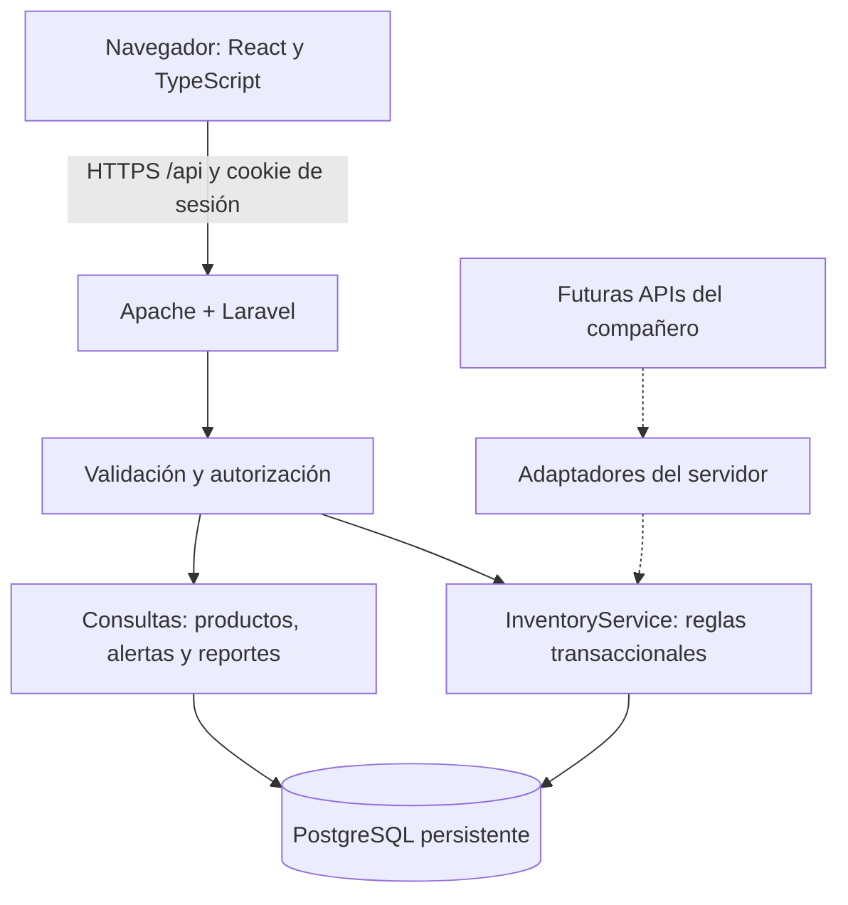
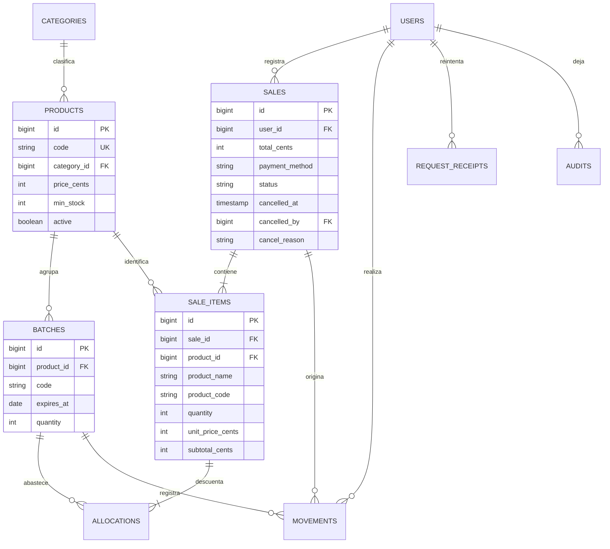
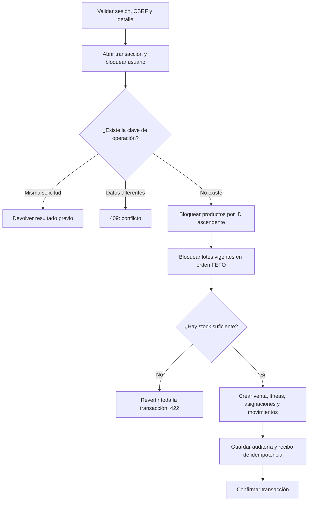
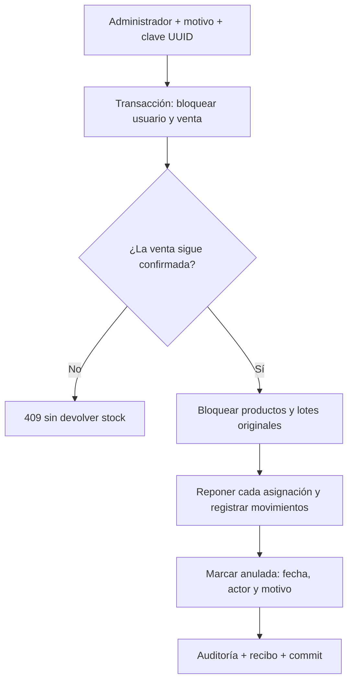

# Arquitectura y consistencia

## Componentes

La interfaz compila con Vite y usa React, Tailwind y CSS propio. Apache sirve recursos estáticos y el controlador frontal de Laravel desde el mismo origen; no hacen falta tokens en localStorage ni CORS amplio. Las credenciales viven exclusivamente en el servidor. Las cookies de sesión son HttpOnly, Secure en el despliegue y SameSite=Lax. Toda escritura exige CSRF.

Los controladores organizan entrada/salida y permisos. Las FormRequest separan validaciones de producto, venta y stock. InventoryService concentra la consistencia. Eloquent expone relaciones; las migraciones añaden índices, claves únicas, foráneas y restricciones CHECK en PostgreSQL. No se introducen microservicios.

## Entidades

`(product_id, code)` es único en lotes. `(user_id, key)` es único en recibos de idempotencia. Los movimientos conservan lote, actor, venta de origen si corresponde, variación firmada, saldo posterior y motivo. No hay campo editable de stock en Product: se calcula sumando lotes; disponible filtra vencimientos. Las ventas guardan nombre/código/precio de cada línea para preservar la historia.

## Registro de venta

FEFO significa «primero vence, primero sale». Se ordena por vencimiento y luego ID para desempatar. Un lote que vence hoy sigue vigente hasta terminar el día local; se consideran vencidos los de fecha anterior. Un fallo en cualquier producto revierte también los productos ya procesados.

Los productos se bloquean antes que los lotes, en orden estable. Entradas, ajustes, ventas y anulaciones siguen este mismo protocolo. Dos usuarios que compiten por una unidad se serializan en la fila del producto. El segundo vuelve a leer los lotes una vez liberado el bloqueo y recibe rechazo si no queda stock. Los bloqueos de fila requieren PostgreSQL; SQLite no demuestra esa propiedad. Hay hasta tres intentos de transacción para interbloqueos detectados por Laravel.

## Anulación

Una repetición con la misma clave devuelve el resultado original. Otra clave contra una venta ya anulada recibe 409. Si el lote original venció desde la venta, se repone físicamente pero sigue excluido del stock vendible; no se cambia su vencimiento.

## Dinero y límites

Todos los precios e importes se guardan en enteros de céntimos. El navegador convierte la entrada decimal separando parte entera y centavos; el backend acepta únicamente enteros y vuelve a calcular importes desde los precios guardados. El total de una venta no supera 2 000 000 000 de céntimos. Cantidad máxima por línea: 10 000. Máximo de líneas distintas: 100. Los reportes suman importes guardados, sin costos ni ganancias.

## Sesiones, autorización y actualización

Laravel regenera la sesión al iniciar, invalida al salir, limita intentos de login y valida usuario activo en cada solicitud. El administrador puede administrar; el vendedor solo consulta catálogo/lotes y registra/consulta sus propias ventas. El servidor impide el acceso aunque se manipule la interfaz. No existe registro público de cuentas.

`useResource` consulta cada 30 s con la página visible, al recuperar el foco y tras operaciones locales. Un contador descarta respuestas antiguas de una misma consulta. Es polling periódico, no push instantáneo. La venta no confía en un valor de stock que estuvo visible en el navegador.

La cabecera CSP restringe recursos al mismo origen, deniega frames y objetos y se complementa con `nosniff` y política de referencias. Los datos de React se escapan al renderizar; no hay HTML suministrado por usuarios. Eloquent parametriza consultas, también la búsqueda con LIKE. En producción, `APP_DEBUG=false` evita mostrar detalles internos ante un error inesperado. HTTPS lo proporciona Render.

## Crecimiento y recuperación

Antes de incorporar integraciones, mantener esta frontera transaccional. Un servicio externo lento nunca debe ejecutarse dentro de los bloqueos de stock. Usar timeouts, reintentos e idempotencia propios de cada proveedor. Para mayor volumen, separar la conexión agrupada de consultas de la conexión directa de migración; añadir colas solo si hay una tarea que las justifique. Respaldos, observabilidad externa y pruebas de recuperación deben definirse antes de uso real con información de clientes.
